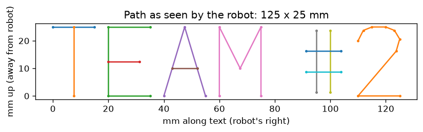

# AR4 MK4 – Team 2 Writing Program

This program drives an Annin Robotics AR4 MK4 arm to write **TEAM #2** on a
whiteboard with a dry-erase marker held at J6. The run starts and ends at a
defined Home position. All motion is under program control, at a low, fixed
speed.

**Demonstration videos:**
- Writing run (on the board): https://youtu.be/9lMpUU2K0Y0
- Dry run in the air: https://youtu.be/b7LZW2sKkTQ
- Writing run (on the board): https://youtu.be/A9swemSFlqM
- Writing run (on the board): https://youtu.be/q0noPdd0gKQ



*Planned pen path as seen from the robot: 125 × 25 mm (4.9 in wide). The text
reads correctly from the robot's side and is upside down to someone facing
the front of the robot.*

## Contents

| File | Purpose |
|---|---|
| `write_team.py` | Main program. Lays out the text with a stroke font, then runs Home → write → Home. |
| `ar4link.py` | Small serial library for the AR4 Teensy (Annin firmware 6.7.1). Every read has a timeout. |
| `jog_teach.py` | Jog tool for moving the marker in 0.5–25 mm Cartesian steps and saving the start point. |
| `teach.json` | Taught start point: the bottom-left corner of the text, with the marker tip touching the board. |
| `config/ARconfig.json` | Snapshot of the AR4 HMI configuration used for calibration: joint limits, directions, DH parameters. |
| `firmware/` | Annin Teensy 4.1 firmware v6.7.1, unmodified, with Annin's license. |
| `requirements.txt` | Python dependencies. |
| `docs/preview.png` | Plot of the planned pen path. |
| `CONTRIBUTIONS.md` | Team member contributions. |

## Hardware and software

- **Robot:** Annin Robotics AR4 MK4, Teensy 4.1 controller.
- **Firmware:** Annin `AR4_teensy41_sketch_v6.7.1`, unmodified.
- **Calibration:** Annin AR4 HMI 6.7 (`AR4.py`), using Auto Calibrate.
- **Host:** Ubuntu 24.04 (aarch64) in a Parallels VM, Python 3.12, with the Teensy USB passed through to the VM.
- **End effector:** a dry-erase marker taped to the servo gripper, pointing roughly straight down.
- **Work surface:** a small whiteboard lying flat in front of the robot. Mark its corners with tape so it can go back in the same place.

## Coordinate frame

Positions are in the robot base frame, in mm:

- **+X:** away from the base.
- **+Y:** the robot's left.
- **+Z:** up.

The text baseline runs toward the robot's right (−Y). Letter tops point away
from the robot (+X). The marker's orientation stays fixed at the taught
orientation throughout, so only the tip position changes.

## Running on a new robot from scratch

Follow these steps in order on any AR4 MK4 (Teensy 4.1). The program runs on
**Ubuntu** (tested on 24.04) with Python 3.10 or newer.

### A. Install the Python dependencies

```bash
cd team2_writer
python3 -m venv venv
venv/bin/pip install -r requirements.txt
```

- **Serial access:** add your user to the `dialout` group (`sudo usermod -aG dialout $USER`), then log out and back in.
- **Tk for the jog tool:** if `import tkinter` fails, run `sudo apt install python3-tk`.
- **VM:** pass the Teensy's USB device through to the VM. In Parallels, use
  **Devices → USB & Bluetooth**. The Teensy briefly re-appears as a different
  USB device while it's being flashed, so pass that through too.

The program finds the Teensy automatically, preferring the stable
`/dev/serial/by-id/usb-Teensyduino_USB_Serial_*` path because `ttyACM` numbers
change on reconnect. If more than one Teensy is connected, give the port
explicitly with `--port`.

### B. Flash the firmware

The program needs Annin firmware **6.7.1**, which is in `firmware/`. Other
versions may use different serial commands.

With the Arduino IDE and Teensyduino, open
`firmware/AR4_teensy41_sketch_v6.7.1/AR4_teensy41_sketch_v6.7.1.ino`, select
**Teensy 4.1**, install the **ModbusMaster** library, and click Upload.

Or, with `arduino-cli`:

```bash
arduino-cli core install teensy:avr --additional-urls https://www.pjrc.com/teensy/package_teensy_index.json
arduino-cli lib install ModbusMaster
arduino-cli compile --fqbn teensy:avr:teensy41 firmware/AR4_teensy41_sketch_v6.7.1
arduino-cli upload  --fqbn teensy:avr:teensy41 -p <port> firmware/AR4_teensy41_sketch_v6.7.1
```

A brand-new Teensy shows up as a RawHID device, not a serial port. Get its port
for the upload from `arduino-cli board list`.

### C. Install the Annin AR4 HMI (used for calibration)

Download **AR4 HMI 6.7** from the Downloads section of
https://www.anninrobotics.com and follow Annin's instructions for
it. On a new robot, check its settings in the HMI first: motor directions,
calibration directions and calibration offsets. `config/ARconfig.json` shows
the values our robot used.

### D. Check the arm before calibrating

1. Release the E-stop, keep it within reach, and clear the work area.
2. Jog each joint a few degrees in the HMI to confirm every motor turns, and in
   the right direction.
3. Run `Test Limit Switches.ar4`. Each switch should read 0 when released and
   1 when pressed.

### E. Then follow "How to run" below

Calibrate, teach the start point, preview, run in the air, then write.

> **`teach.json` is specific to our robot and board position.** On another
> robot, or if the whiteboard moves, **re-teach the start point** (step 2
> below) before running anything else.

> **Only one program can use the arm's serial port.** Close the stock AR4 HMI
> before running `jog_teach.py` or `write_team.py`. Both tools refuse to start
> while it is open.

## How to run

### 1. Calibrate

Power on the arm and release the E-stop. Open the AR4 HMI, select the Teensy
port and press **Auto Calibrate**. Wait for both stages to report success,
then **close the HMI**.

### 2. Teach the start point (only when the board moves)

```bash
venv/bin/python jog_teach.py
```

1. Click **Go 20 mm above saved START**, or jog to the board using the X/Y/Z buttons.
2. Step **Z−** in 1 mm, then 0.5 mm, steps until the marker tip just touches the board at the bottom-left corner of the text, as seen from the robot.
3. Click **Save START**, then close the window.

The start point is stored in calibrated robot coordinates. It stays valid
after recalibrating, as long as the whiteboard doesn't move.

### 3. Preview (no motion)

```bash
venv/bin/python write_team.py --preview
```

This prints the text size and writes `docs/preview.png`.

### 4. Dry run in the air

```bash
venv/bin/python write_team.py --air
```

This runs the full sequence with the pen 10 mm above the board. Check three
things: the text is the right way round, it's in the right place, and the
marker stays at an even height over the whole word.

### 5. Write

```bash
venv/bin/python write_team.py
```

### Options

| Option | Default | Meaning |
|---|---|---|
| `--text` | `TEAM #2` | Text to write. Glyphs: `T E A M # 1 2 3 4` and space. |
| `--height` | `25` | Letter height in mm. Width scales with it: 25 mm gives 125 mm. |
| `--speed` | `10` | Speed as a percentage of maximum, limited to 1–25. |
| `--press` | `0.5` | mm below the taught touch height. Increase it if strokes are faint. |
| `--hop` | `8` | Pen-up clearance between strokes, in mm. |
| `--air` / `--air-offset` | off / `10` | Run the whole path this many mm above the board. |
| `--port` | auto | Serial port, if auto-detection finds none or several. |

## How it works

1. **Layout:** each character is a set of straight polylines on a 12 × 20 grid,
   scaled to `--height` and placed left to right with a fixed gap.
   `TEAM #2` comes to 12 strokes.
2. **Mapping:** each point (u along the text, v up the letter) maps to
   `start + u·(0,−1,0) + v·(1,0,0)`. Z comes from the taught start height,
   minus the pen press, plus any lift.
3. **Motion:**
   1. If the marker starts within 30 mm of the board, lift straight up first.
   2. Joint move to **Home**: J1–J6 = 0, 0, 0, 0, 45°, 0. This is the same pose
      as the HMI's `Home.ar4` and the pose Auto Calibrate finishes in.
   3. Joint move to 28 mm above the first stroke.
   4. For each stroke, use straight-line (`ML`) moves to go above its start,
      pen down, draw each segment, and pen up.
   5. Lift 30 mm, then return to Home.
4. **Sync:** on exit, the arm's joint angles are written back into the HMI's
   config. The HMI sends its saved angles to the board when it starts, so a
   stale value would otherwise corrupt the calibrated position.

## Safety

- **Speed:** every move runs at 10% by default, and the code caps speed at 25%.
- **Testing order:** always run `--preview`, then `--air`, before writing on the
  board, especially after changing the size, start point or board position.
- **E-stop:** keep it within reach and the work area clear during every run.
- **Limits:** all targets stay inside the calibrated joint limits. The firmware
  rejects any unreachable or out-of-limit move, and the program then stops and
  reports it instead of continuing.
- **Timeouts:** every serial read has one. A board that stops responding gives
  an error message, not a frozen program.
- **Interrupting:** Ctrl+C stops after the current move. Use the E-stop to stop
  motion immediately.

## Known issues and lessons learned

- **Never use mm/s speed with firmware 6.7.1.** The firmware's step timing for
  linear moves at mm/s speed (`Sm`) divides by roughly `1.2 × steps − 36`. Short
  moves of about 30 motor steps (1–3 mm) therefore get near-infinite step
  delays, and the board stops responding until its USB is unplugged and the arm
  is recalibrated. This code always uses percent speed (`Sp`).
- **Don't run two programs on the port.** When the stock HMI opens, it sends its
  saved joint angles to the board. If those are stale, for example after the HMI
  froze mid-jog, the board's idea of where the arm is becomes wrong. This
  happened once to J4, by about 25°.
- **The stock HMI can freeze.** Its serial reads have no timeout, so a lost reply
  locks up the window. Use `jog_teach.py` for positioning.

## Recovering from a hang

If the board stops responding:
1. Unplug the Teensy USB for 5 seconds and plug it back in.
2. Confirm Parallels connects it to the VM.
3. Recalibrate in the HMI, then close it.

`teach.json` is still valid afterwards.

## Team

See [CONTRIBUTIONS.md](CONTRIBUTIONS.md).

## License

- **Annin firmware** (`firmware/`): © Chris Annin / Annin Robotics. It's
  redistributed unmodified, for non-commercial educational use, under the terms
  in `firmware/ANNIN_LICENSE.txt` and the sketch header.
- **Annin configuration** (`config/ARconfig.json`): exported from Annin's AR4 HMI
  6.7, under the same terms.
- **Our code** (`*.py`): written by Team 2 for this course assignment.
